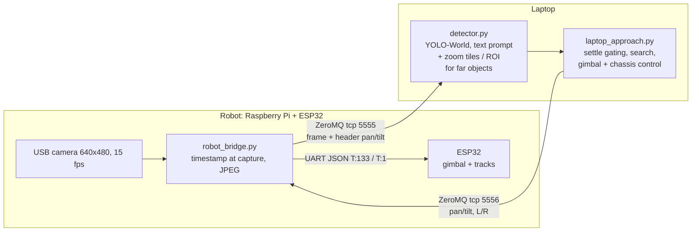

# Text-guided search and approach for a UGV

A Waveshare UGV Beast is given a text description ("a yellow chair"), searches for the object with its
pan-tilt camera, locks on it and drives up to it. The detector is open-vocabulary (YOLO-World), so the target is
changed by typing a sentence, without training data. The core problem is that this detector is slow on our
hardware (~100 ms per frame on the laptop CPU, delayed by Wi-Fi), while the gimbal and the chassis need a smooth
signal. The project builds fast components around it and measures what each one adds (V1-V4).

Team: Arsen Botsko, Ivan Zarytskyi, Zakhar Veresniuk (UCU, AI course 2026). Proposal:
`Proposal_Veresniuk_Botsko_Zarytskyi-1.pdf`. Operational details (networks, setup, tuning): `HANDOVER.md`.

## Pipeline



State machine in `laptop_approach.py`: `SEARCH` (stop-and-look gimbal sweep with zoomed tiles: first around the
area where the target was last seen, then a full sweep, then a short chassis spin) -> `TRACK`
(gimbal centres the target, chassis turns toward the bearing and drives) -> `ARRIVED`: the distance to the
object's base on the floor, from camera height + gimbal tilt + calibrated angle of the box bottom
(d = cam_height / tan(angle below horizon)), is <= `--arrive-dist` (0.45 m); slows down over the last
`--slow-dist`. Safety stop: box height / image height >= `--arrive-ratio` (0.85). Up to `--miss-frames` missed frames are ignored, up to `--lost-frames` the robot holds still (`LOST`),
then it searches again, starting where the target was last seen.

## Variants (study design from the proposal)

| Variant | What | Status |
|---|---|---|
| V1 | gimbal driven directly by the latest detection (baseline) | done, measured below |
| V1 + approach | search + drive to the object, settle gating, zoom for far objects | done, needs robot runs |
| V2 | + CSRT tracker between detections + PID, detector in its own thread | after midterm |
| V3 | + Kalman filter with delay compensation (late detections applied at capture time) | after midterm |
| V4 | + CLIP identity check on re-acquisition (template + text) | after midterm; text-only CLIP check tried (`--attr-check`), not general |

## Results so far (midterm)

Data: 30 recorded sequences, 6 scenarios x 5 (S1 slow, S2 fast, S3 occlusion, S4 target leaves the frame,
S5 distractor of the same class, S6 low light), 2 rooms, 20 s each at 15 fps, recorded while V1 drove the gimbal.
Quick ground truth: one frame every 2 s (308 frames), the target box chosen by hand among detector candidates
(`eval/candidates.py`, `eval/make_gt.py`). Full CVAT annotation is planned.

**V1 baseline (closed loop, 298 labelled frames):** target in frame 92% overall (S4 "leaves the frame": 71%),
centring error 13.3 deg mean / 46 deg p95; only 33% of frames near the centre in S2 (fast motion).

**Detector choice (open loop, laptop CPU):** YOLO-World v2 **s** at 640 -- 102 ms/frame, correct lock 78%.
m / l / x: 265 / 551 / 806 ms and 74 / 50 / 57% at the same threshold; 1280 input: 425 ms, 59%;
OWLv2 (the proposal's heavier alternative): 4.2 s, 41% (best in low light, but locks on look-alikes); OWL-ViT: 12%. When the
target is not in view, s640 still reports a "dark box" in 76% of frames -> wrong locks, the motivation for V4.

**Far objects (object-size study):** correct lock of V1 drops to 27% for 20-40 px boxes and 3% below 20 px
(~5 m and ~10 m for a 0.4 m object). Zoomed tiles in SEARCH: 44% / 22%; zoomed crop around the target in TRACK:
60% / 44%; at ~7x / ~2.5x the time per frame (`eval/README.md`).

**Approach mode fixes (2026-10-24, need robot runs):** the camera jumps (one missed detection swung the gimbal
55 deg, 14 jumps > 20 deg in a 40 s log) came from using frames taken while the gimbal was still moving; fixed.
Arrival is now by ground distance (stop ~0.45 m from the object) instead of box size (stopped ~1.2 m from a chair).

Details, method and limits: `eval/README.md`.

## Repository

| File | Runs on | Purpose |
|---|---|---|
| `robot_bridge.py` | Pi | camera stream, command forwarding, latency log, track speed cap + stop watchdog |
| `laptop_v1.py` | laptop | V1 baseline (gimbal only) |
| `record.py`, `run_seq.sh` | laptop | record every frame (+ V1 tracking) for the S1-S6 sequences |
| `laptop_approach.py` | laptop | search + gimbal + chassis approach (`--headless --duration` for tests) |
| `detector.py` | laptop | YOLO-World text detector + zoom tiles / ROI for far objects, optional CLIP attribute check |
| `replay_bridge.py` | laptop | fake bridge that streams a recording, to test the laptop scripts without the robot |
| `calibrate.py` | laptop | checkerboard calibration -> `calib.npz` (fx ~ 273 px, HFOV ~ 100 deg) |
| `eval/` | laptop | ground truth, detector benchmark, metrics (`eval/README.md`) |

## Quick start

```
pip install -r requirements.txt
# robot (ssh ws@192.168.50.5):  pkill -f app.py; ~/ugv_rpi/ugv-env/bin/python ~/robot_bridge.py
python laptop_approach.py --robot 192.168.50.5 --prompt "a yellow chair" --no-drive   # gimbal only first
python laptop_approach.py --robot 192.168.50.5 --prompt "a yellow chair"
# without the robot:
python replay_bridge.py --seq rec/S1_seq04 --loop &
python laptop_approach.py --robot 127.0.0.1 --prompt "a yellow chair" --no-drive --headless --duration 20
# metrics
python eval/run_detectors.py && python eval/metrics.py
```

Recordings (400 MB) are not in git; download them from the team Google Drive and link or unpack them as `rec/`.
